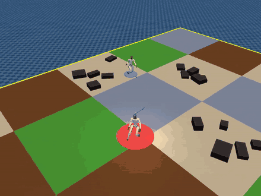

# Hi, I'm Nhut Thanh Nguyen 👋

I'm an **enthusiastic AI Engineer** and an MSc student in Artificial Intelligence & Machine Learning at **TU Darmstadt**. I'm also a member of **AI Grid**, a network for young AI talent funded by the German Federal Ministry of Research, Technology and Space.

I love making AI work under real constraints: LLM and RAG systems that run offline on one consumer GPU, and humanoid robots trained on a 4 GB laptop GPU. I learn best by building things from scratch, measuring them honestly, and writing down what actually worked.

---

### 🔬 What I'm working on

**Offline multimodal RAG for tropical-disease diagnosis.** This is part of the PACE-UP project, with 28 institutions in 15 countries.
- **The problem:** clinicians in low-income regions often have no reliable internet and no GPU servers.
- **What I built:** a multimodal (clinical text + image) differential-diagnosis pipeline that runs fully offline on **one consumer GPU**:
  - hybrid dense + sparse retrieval in **Qdrant** with a cross-encoder reranker
  - context-conditioned image captioning (+16.6 points of top-5 accuracy)
  - **vLLM** serving (~60% faster)
  - an evaluation harness with 95% Wilson confidence intervals
- **Result:** a local 4-bit 27B model reaches **95.8% top-5 accuracy** at 30 diseases, in the same range as a commercial cloud LLM.

*First-author journal paper in preparation; the code will follow.*

---

### 🤖 Featured project: [Tom & Jerry G1](https://github.com/ga1nang/Tom-and-Jerry-G1)

**Humanoid locomotion and a self-play game of tag, trained with PPO I wrote from scratch.**

*The runner trips into a pile of rocks, gets back up in about 2 s and keeps running. A moment later the chaser catches it.*

- **PPO from scratch** (~370 lines, no RL library): asymmetric actor-critic, GAE, KL-adaptive learning rate, timeout bootstrapping. The robot is a 29-joint Unitree G1, simulated in MuJoCo Warp (mjlab).
- **Walk → run → sprint:** a chain of curriculum runs takes the robot from walking at 1 m/s to sprinting at **4.96 m/s with zero falls**. Total training time was ~5.6 h on a laptop GPU.
- **Reward debugging:** two reward traps found and fixed. Told to sprint, the policy learned to stand still; later, it stopped turning. Both were fixed with linear penalties.
- **Self-play tag:** a zero-sum game where one network learns both roles. The learned chaser catches a scripted runner **87.9%** of the time; a scripted chaser manages only 27.7%.
- **Getting back up:** on a grass / mud / rock arena, I switch a frozen stand-up policy in per robot. Falls stop deciding the game, and the learned strategies matter again.

---

### 🛠️ Tech stack

Python · PyTorch · Reinforcement Learning (PPO, self-play) · MuJoCo · RAG · Qdrant · vLLM · QLoRA · Hugging Face · FastAPI · Docker · MLflow · Langfuse · W&B Weave · Git

---

### 📫 Contact

nnthanhmx@gmail.com • [LinkedIn](https://www.linkedin.com/in/nhut-thanh-nguyen-2b7005218/)
